# Stock NWN:EE rig pipeline and NWNAnalog comparison

The stock reference is the Windows x64 `nwmain.exe` with SHA-256 `3b7cb1252e0edb2ce22d7971f333aade027039ae30a45b4bc64732c3e6bec73a`. Stock addresses are PE virtual addresses. Port references describe the current ordinary actor path. Headless and graphical measurements refer to the owned DensePerfCX workload unless a row names another fixture.

| Lane | Stock and client boundary | Detailed map |
| --- | --- | --- |
| Load and bind | Model resource request through inherited clips, physical Part IDs, instance ownership and ready rig | [Load and bind](load-and-bind.md) |
| Evaluate | Gameplay request through admitted runs, clocks, controllers, blending, and cues | [Playback and controllers](playback-and-controllers.md) |
| Consume and retire | Local fields through world pose, attachments, skinning, draw submission, and last-owner release | [Pose consumers](pose-consumers.md) |

## End-to-end map

```mermaid
flowchart TD
  subgraph stock[Stock NWN:EE]
    S0[Typed creature creation or masked appearance update] --> S1[Resolve model resource and retain parsed Model]
    S1 --> S2[Construct Gob and typed Parts]
    S2 --> S3[Resolve clip and admit an AnimRun]
    S3 --> S4[Scene Animate advances visible or forced runs]
    S4 --> S5[Match authored nodes to Parts and update local fields]
    S5 --> S6[Dispatch authored events for each run]
    S5 --> S7[Resolve world transforms at consumer boundaries]
    S7 --> S8[Draw rigid, skinned, and other Part types]
    S7 --> S9[Update attachments, bounds, lights, shadows, and effects]
    S8 --> S10[Retire Part, Gob, and last-owned model resources]
    S9 --> S10
  end
  subgraph port[NWNAnalog ordinary actor path]
    P1[Resolve model and prepare worker data] --> P2[Build actor nodes, bindings, and AnimationPlayers]
    P2 --> P3[Select clip and prepare private tracks on demand]
    P3 --> P4[Advance Godot players and blend cached tracks]
    P4 --> P5[Publish local Node3D transforms]
    P5 --> P6[Restore manual fields and dispatch queued cues]
    P6 --> P7[Synchronize attachments]
    P7 --> P8[Publish rigid meshes and optional skin poses]
    P7 --> P9[Update shadows, effects, and collision consumers]
    P8 --> P10[Retire actor and release renderer and asset references]
    P9 --> P10
  end
```

Stock scene cadence begins at `CGuiMan::UpdateAndRender` (`0x1401f70e0`), which distributes a separate timer snapshot delta to each admitted scene view. `Scene::Animate` (`0x1400c5210`) walks its Gobs in reverse order and rereads the live count after callbacks. `Gob::Animate` (`0x14004dbd0`) advances admitted runs and calls `AnimateHierarchy` (`0x14004fe90`) before each run's event interval. The timer worker updates clock snapshots. Rig evaluation inherits the GUI/render caller thread. [Stock clock and Scene order](../../godot-client/tools/stock-render-tree/original-scene-animation-nonemitter.md#clock-and-caller-thread)

For ordinary NWNAnalog playback, the worker derives and indexes original clips. Each live actor owns its paths, AnimationLibrary, player, and clocks. Packed data and prepared transform templates are reused when their inputs are exact. The template cache supplies newly copied tracks during materialization. `ModelRigs._update` then advances each active private player, restores manual fields, dispatches queued cues with its playback serial, synchronizes attachments and publishes skins where present. [Worker rig preparation](../../godot-client/systems/native_data/asset_service.gd#L502) · [Materialization](../../godot-client/systems/model_rigs.gd#L335) · [Steady update](../../godot-client/systems/model_rigs.gd#L672)

## Work differences and priority

| Priority | Stage and implementation owners | Extra work or architectural difference | Evidence and next measurement |
| --- | --- | --- | --- |
| 1 | Steady controller evaluation. Stock `AnimateHierarchy` and `MdlNode::InternalControl` against our `ModelRigs._clip_resource` and Godot `AnimationMixer` | Stock visits authored controllers and can retain an omitted field. Our controlled-channel union adds one-key defaults for absent controllers. Each active Godot instance still visits its tracks and updates mixer caches before applying values. | **688 of 3,014** current tracks were generated defaults. The entire `AnimationPlayer.advance()` scope cost **2.366–2.372 ms** across 68–69 calls. Cost attributable to each extra track is unmeasured. The blanket omission trial changed 13 of 60 transition frames. The next comparison should preserve native reset and blend semantics and split controller evaluation from pose application. [Track census](../native-pipeline-comparison.md#live-rig-advancement-and-generated-default-tracks) · [Transition evidence](../native-pipeline-comparison.md#omitted-properties-in-clip-transitions) · [Mixer track loop](../../godot-client/.cache/native-text-build/source/scene/animation/animation_mixer.cpp#L1223) |
| 2 | Pose application. Stock local Part fields and invalidation against our Godot `AnimationMixer::_blend_apply` and `Node3D` | The Godot path accumulates track values, resolves the destination object, and calls general-purpose transform setters. The engine already combines position, rotation, and scale when all three are active. Partial use can still issue several setters and traverse transform dirtiness. Some downstream rendering updates are already coalesced or compare equality. | A bounded synthetic partial-track fixture produced two local transform notifications per advance. The cost on a representative actor family is unmeasured. The scope to isolate is the mixer application and propagation tail, with attachments and visibility still active. [Fixture and setter evidence](../native-pipeline-comparison.md#omitted-properties-in-clip-transitions) · [Mixer application](../../godot-client/.cache/native-text-build/source/scene/animation/animation_mixer.cpp#L1902) |
| 3 | Runtime admission. Stock `Scene::Animate`/`Gob::Animate` against our active model lists and `ModelRigs._update` | Stock has scene, visibility, force, model, and fade gates. Our per-rig process suspension already handles dormant completed playback. An admitted current clip can still evaluate independently of draw visibility. Clock progress, cues, shadow participation and attachment effects have distinct eligibility conditions. | The current captures count active players. They do not isolate cost for rigs outside all consumers. Measure per-consumer admission before treating offscreen playback as redundant. [Stock gates](../../godot-client/tools/stock-render-tree/original-scene-animation-nonemitter.md#scene-gob-and-part-order) · [Player update](../../godot-client/systems/model_rigs.gd#L672) |
| 4 | Combat pose handoff. Stock owner fields read by `SetBaseAnimation` against our `CombatAnimation.base_frame` and `update` | Two client producers copy the pivot global position and rebuild forward from the same yaw. Each reads mutable actor state, so a same-epoch transform must be verified before skipping the second copy. | Source-level duplicate producer, unmeasured. A transform revision would have to cover prediction, facing overrides, and movement between the two calls. [Base dispatch](../../godot-client/systems/combat_animation.gd#L126) · [Update sweep](../../godot-client/systems/combat_animation.gd#L352) |
| 5 | Skin publication. Stock typed skin draw path against our `ModelRigs` skin publication | The ordinary Node3D route can compose a parallel rigid hierarchy and force update a 65-slot parentless skin skeleton after testing for changed slots. The retained Godot implementation scans all bones for each root on that force path. | A 65-root force implies up to **4,225** dirty checks in the retained source. Confirm the installed engine body and measure representative skins. The chosen live DensePerfCX timing window reported zero actor skin meshes, so this cost is outside that window's animation result. [Skin lane](pose-consumers.md) · [Measured scope](../native-pipeline-comparison.md#animation-attachments-and-effects) |
| 6 | Load and bind. Stock parsed-model, supermodel, and Part ownership against our worker, prepared bundles and actor node construction | Stock can retain the ancestor `Animation*` and put descendant position scale in an `AnimRun`. We build node-filtered inherited clip and track views and carry scale to deferred key preparation. Current MDL reuse, packed keys, lazy bound tracks, and typed templates already remove repeated preparation. | Exact key expansion fell 76% in the owned replay. In the nine-layout fixture, detached templates cut repeated materialization further from **93–96 ms** to **74–76 ms**. Four graphical runs had overlapping steady frame intervals. Isolate inherited-view projection and node construction from the already reduced key work. [Load lane](load-and-bind.md) · [Setup and graphical receipts](../native-pipeline-comparison.md#exact-animation-reuse-in-denseperfcx) |
| 7 | Binding setup. Stock authored clip lookup and Part associations against our `ActorInstance` and `ModelRigs._clip_resource` | Actor assembly linearly checks the clip list before lazy playback consults the prepared name index. The clip builder eagerly creates a default-channel dictionary for every lookup and resolves paths again for different properties of the same Part. | Three concrete repeated operations with unmeasured costs. First seek and the zero-delta commit also overlap in pose evaluation, with distinct initial events and publication dependencies to verify. [Binding setup evidence](load-and-bind.md#differences-and-work-attribution) |
| 8 | Lifetime replacement. Stock `Gob` and last-reference teardown against our `LiveWorld` and `CombatPresentation` | One client replacement route forgets the combat owner before entering the ordinary removal path, which forgets the same ID again and scans pending combat records again. | Confirm the branch and that no enqueue can intervene before removing the repeated scan. This is replacement work. [Retirement evidence](pose-consumers.md#work-differences-and-priorities) |

Priorities 1 and 2 share the same measured player-advance span. The standard skin path and the explicit verified-native profile differ. The latter can select a custom palette publisher and single-pass force routine. Its time and source evidence should be evaluated under that separate configuration. [Profile selection and skin owners](pose-consumers.md#nwnanalog-consumers)

## Previously resolved or rejected avenues

- The former same-input dispatch estimate of **0.695–0.720 ms** predates the current exact `has_current_playback` gate. The ordinary combat path can already skip equivalent commands. A native `PlayAnimation` shortcut is flag-dependent, so the source does not support calling every stock repeat a no-op. [Historical dispatch census](../native-pipeline-comparison.md#original-base-playback-dispatch-and-repeated-mixed-client-requests) · [Current exact guard](../../godot-client/systems/model_rigs.gd#L477)
- Exact primary-clip phase matches were **5.4%** of settled advances and **5.1%** of paced advances in the owned replay. Only **197 of 7,175** locomotion samples matched another same-frame sample. This is a sample count, with no isolated CPU saving. Private blend and application state further restrict reuse. A whole-frame sampler cache remains outside the selected path. [Exact phase evidence](../native-pipeline-comparison.md#exact-animation-reuse-in-denseperfcx)
- Current static-model preparation forwards the parsed base result into the inherited model path. The older duplicate base decode measurement describes work removed from the ordinary branch. [Current direct handoff](../../godot-client/systems/native_data/asset_service.gd#L204) · [Historic base parse comparison](../native-pipeline-comparison.md#discarded-mesh-preparation-and-base-parse-reuse)
- The isolated inherited-gait trial removed `AnimationPlayer` and held exact sampled poses and cues across 49 rigs. Its sparse native evaluation measured about **1.73–1.76 ms**, compared with **1.33–1.40 ms** for the existing player in that fixture. The result rules against promoting that particular replacement from source similarity alone. [Inherited-gait trial](../../godot-client/.cache/stock-sparse-gait-b/native-only-gait-a.json)

The different scopes of the stock profiler and the Godot frame profile prevent attributing their full numerical gap to any single row.

## Godot rig propagation trial

In the owned DensePerfCX replay, the 74 ordinary rigs spent **1.53 ms** per sampled idle frame in `AnimationMixer::advance`. Transform propagation took **0.83 ms**, sampling and blending took **0.44 ms**, and exclusive pose application took **0.15 ms**. During paced updates, propagation took **0.75 ms** of the measured **1.51 ms**. These zones cover synchronous work and leave deferred scene and renderer work outside the split. [Paired phase measurements](../../godot-client/.cache/native-tracy/rig-phases/rig-phase-d/grouped-trace-a/paired-summary.json)

The candidate publishes an eligible position and rotation through one propagation. It uses Godot's existing rotation setter and retains the ordinary setters when synchronous local notifications or frame interpolation are active. In the matched idle window, propagation calls per pose fell from **41.49 to 35.24**, a **15.0% reduction**, and advance time fell from **1.53 to 1.48 ms**. The paced window also removed **15.1%** of propagation calls and measured **1.51 to 1.44 ms** in advance. A headless fixture passed **3,976 exact comparisons** of poses, hierarchy, scale, cues, and notifications. [Candidate build](../../godot-client/.cache/native-tracy/rig-phases/rig-phase-d/build-output/receipt.json) · [Pose fixture output](../../godot-client/.cache/native-tracy/rig-phases/rig-phase-d/pose-check-a/fixture.stdout.log)

| Profiling-off Windows replay | Control | Candidate |
| --- | --- | --- |
| Mean frame interval | 7.89–7.91 ms | 7.67–7.75 ms |
| p95 frame interval | 8.87–8.89 ms | 8.62–8.65 ms |
| Catalog mounted to area ready | 2.79–2.88 s | 2.95–3.10 s |
| Sampled peak private memory | 4,326–4,333 MiB | 4,332–4,341 MiB |

The four runs used the same replay, viewport and separate render thread, with Tracy disconnected and detailed profiling disabled. Both private builds failed in engine shutdown after the measurement window. One candidate run reported an access violation after the render-device finalization error, and the other three runs reached the thread-release assertion. These results support a release-format follow-up for the work reduction. The loading difference and shutdown failures keep the candidate private pending that check. The follow-up applies the repository's existing render-thread shutdown fix to both engines. [Control A](../../godot-client/reports/rig-phase-c-timing-control-a.json) · [Candidate A](../../godot-client/reports/rig-phase-d-timing-grouped-a.json) · [Candidate B](../../godot-client/reports/rig-phase-d-timing-grouped-b.json) · [Control B](../../godot-client/reports/rig-phase-c-timing-control-b.json) · [Existing shutdown fix](../../godot-client/tools/perf140/render/godot-rd-thread-return.patch)

The release candidate passed **3,976** pose checks and completed its initial replay with engine exit code 0. The user then ran the same pinned executable on the owned local server and reported a **10–15 FPS** improvement over their previous session. One 47-second live sample window recorded a median **87 FPS** at **3440×1369** with particles on. The live engine exited normally. Its log still contains empty-image update errors that also appeared in the control menu check. The matched release pair isolates the C++ pose change from differences in build and launch settings. [Release candidate provenance](../../godot-client/.cache/native-140fps/render-agent/engine-rd-nwn-rig-apply-release-b/patched.receipt.json) · [Live performance log](../../godot-client/reports/rig-apply-user-review-1795428199700.performance.jsonl) · [Live shutdown report](../../godot-client/reports/rig-apply-user-review-1795428199700.json)

The four uninstrumented release replays all exited with code 0. Identical controls measured **6.99 ms** and **7.96 ms** mean frame time, bracketing both candidate runs at **7.55 ms** and **7.86 ms**. Catalog-to-area readiness was **3.24–3.30 s** for the controls and **2.97–3.32 s** for the candidate. Peak sampled private memory across all four runs was **3,942–3,957 MiB**. The existing empty-image update diagnostics persisted. [Control A](../../godot-client/reports/rig-phase-c-release-control-a.json) · [Candidate A](../../godot-client/reports/rig-phase-d-release-grouped-a.json) · [Candidate B](../../godot-client/reports/rig-phase-d-release-grouped-b.json) · [Control B](../../godot-client/reports/rig-phase-c-release-control-b.json)

Eight alternating windows within one release process kept the scene, renderer, and **76 eligible players** fixed. Mean frame interval across the four windows per setting moved from **9.18 ms to 8.85 ms**, and mean window p95 moved from **10.50 ms to 10.18 ms**. Grouping won three of four adjacent comparisons. The ordinary launcher now selects the pinned release engine for standard gameplay when its build artifacts are installed. The default-runtime startup check selected that executable and exited successfully. [One-process comparison](../../godot-client/reports/rig-release-toggle-a.json) · [Engine patch](../../godot-client/native/engine_patches/animation-mixer-batch-position-rotation.patch) · [Default launcher verification](../../godot-client/reports/rig-apply-standard-startup-1795429272969.json)

Standard setup now builds the same release engine from pinned sources. A full build reproduced executable SHA-256 `e18349d0080c4d95df135d5401cfa01ad2d3d280b59f260a809fff3ddc2643b6`, exactly matching the executable used in the local play test. The ordinary launcher selected the installed engine with no runtime option and passed the headless startup check with zero public connections. The prepared release package also resolved to the same engine hash. Report and cache links in this document refer to local validation data. [Build inputs](../../godot-client/client-runtime-lock.json) · [Standard setup](../../godot-client/tools/setup.ps1)

The last live profile measured about **3.49 ms** in the world callback. Its pose-input dispatch took **1.73 ms** and its motion update took **1.34 ms**. Those are candidates for removing repeated per-entity work and batching remaining numeric work. The main rig application and sampling work already runs in C++. [Live performance log](../../godot-client/reports/rig-apply-user-review-1795428199700.performance.jsonl)

## Verification and coverage

REA identified the pinned x64 executable and SHA-256. An independent read of that PE rechecked **34** direct relative calls in the animation ledger and **19** in the teardown ledger, with matching targets at every checked instruction. The creature primary vtable entry at `0x140e475d8` also resolves to `CNWCCreature::LoadModel` at `0x140802cc0`. The lane reports record additional checked dispatch bytes, parser calls, palette calls, and the case conditions retained by the Ghidra evidence. [Animation edge ledger](../../godot-client/tools/stock-render-tree/original-scene-animation-nonemitter-ledger.json) · [Teardown edge ledger](../../godot-client/tools/stock-render-tree/model-gob-last-reference-pool-teardown-ledger.json) · [Creature model-load entry](../../godot-client/tools/stock-render-tree/creature-model-load-virtual-source.md)

The `+0xf0` literal-call screen separated two placeable-marker paths and one projectile-owner path from the creature. Tracing the concrete Creature constructor then found four `call rbx` sites with `c_dummy` and selector `0xff`. Three belong to the connected game-object construction route through `0x14079bce0` and `0x1407857f0`. The fourth constructs a Creature in the projectile message handler. These sites close the constructor-return branch into `CNWCCreature::LoadModel` and its six factory variants. The ordinary named appearance change uses a separate type-5 message path through `0x14077fe10` to `CNWCCreature::SetAppearance`, its typed base-model dispatch and per-Part updates. [Exact load sites and ordinary appearance path](load-and-bind.md#network-creature-construction-and-ordinary-appearance-changes)

Stock appearance invalidation is a major loading difference. Its masks distinguish a full body change from a palette, head, tail, wing or equipment change. Our model signature filters exact and name-only repeats. Other changed appearance or equipment bytes can schedule fresh actor assembly, depending on the visual update path. Count model requests, Parts rebuilt, bindings recreated and publication time for an equipment change, a palette change and a complete shape change separately. Full shape replacement still carries the actor lifetime, effect anchors and current playback to the new owner. [Stock per-Part gates](../cx-alloy-pipeline-comparison.md#appearance-equipment-and-attached-effects) · [Client signature](../../godot-client/systems/native_render/live_world.gd#L401) · [Client construction](../../godot-client/systems/native_render/actor_instance.gd#L212)

The stock graph covers the admitted original binary and ASCII model families, run and controller evaluation, inherited and attached Parts, skin and rigid draw owners, and resource retirement. Exact per-branch runtime frequency and relative costs of interpolation, application and auxiliary pose consumers remain measurement questions. Allocation-failure alternatives and dynamically registered callbacks retain their observed conditions in the lane reports.
