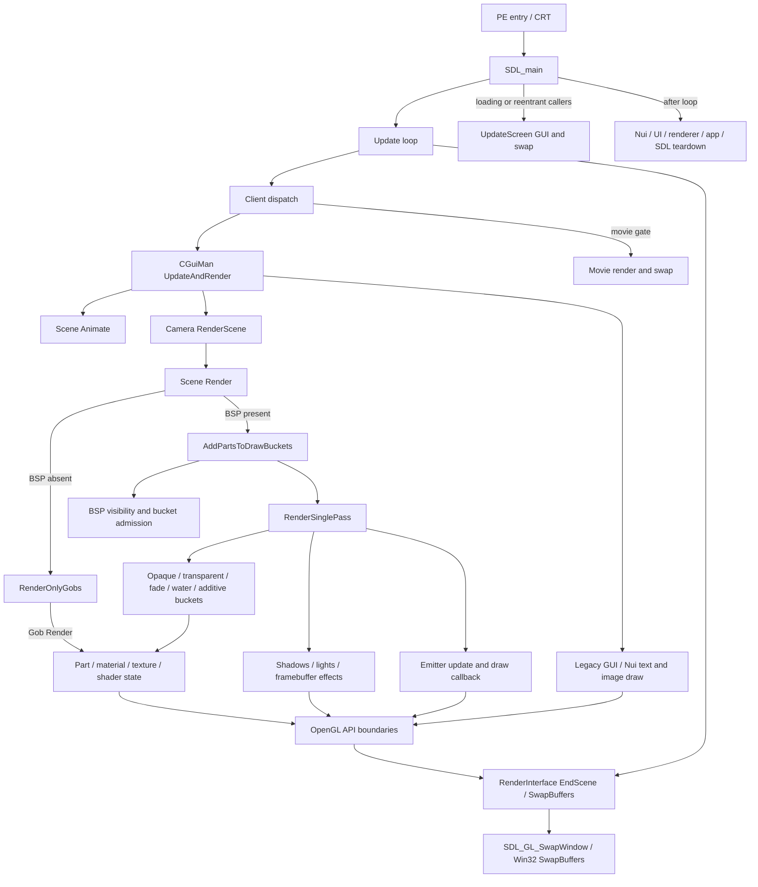

# NWN-75: original native render tree

Status: **partial investigation**. This is a map of the installed original binary only. A named call is not marked closed until its branches reach identified native or external API boundaries. Ghidra pseudocode describes analyzed machine code, not original source. Addresses are image virtual addresses for the pinned PE below. The [coverage ledger index](coverage-ledger-index.md) locates the separate branch ledgers and their unresolved boundaries.

## Binary and evidence rules

| Item | Value |
| --- | --- |
| Original executable | `C:/Users/Niflheim/Desktop/Tools/Local Tools/FullDecomp/NwnRootInstall/bin/win32/nwmain.exe` |
| SHA-256 | `3b7cb1252e0edb2ce22d7971f333aade027039ae30a45b4bc64732c3e6bec73a` |
| Format | Windows PE, x86-64 |
| Provider | REA/Ghidra 12.1.4, default auto analysis, ephemeral read-only program |
| Analysis profile digest | `ab1af6a0e002de5d4940f7e3d2cfd844cfe45f918fcd3678b343002640413374` |

The existing original-binary dossiers in `tools/native_parity/visibility/evidence/native-presentation-procedures-v1.json` and `tools/perf140/render/evidence/` are supporting observations. The address-level discoveries below were rechecked through the active REA session. Some virtual calls have no ReferenceManager call edge; their targets are grounded in a constructor's vtable reference and the corresponding original PE bytes. No runtime branch frequency or worker ownership is inferred from a static edge alone.

## Per-frame roots and confirmed spine

```text
PE entry (0x140c11bdc)
  → CRT selector (0x140c11a00; after security cookie and initialization gates)
    → SDL Windows-main wrapper (0x140cc87c0; after command-line preparation)
      → SDL_main (0x140046340)
        → Update (0x1400448b0)
          → app-manager client dispatch (0x1406ac470 → 0x1406db800)
            → CGuiMan::UpdateAndRender (0x1401f70e0)
              → Scene::Animate via scene-view scene vtable +0x20 (0x1400c5210)
              → Camera::RenderScene via scene-view camera vtable +0x10 (0x14005a5d0)
                → Scene::Render via scene vtable +0x18 (0x1400cc730)
                  → no-BSP: Scene::RenderOnlyGobs (0x1400cf9b0)
                  → BSP: Scene::AddPartsToDrawBuckets (0x1400c38f0)
                    → Scene::RenderSinglePass via scene vtable +0x210 (0x1400d0f10)
          → posted strings and console overlay
          → RenderInterface::EndScene and SwapBuffers (0x1400bf390)
            → GLRender::SwapBuffers (0x1400bb640) → SDL_GL_SwapWindow (0x140ab16b0)
              → built-in SDL Windows backend (0x140af3a60; conditional)
                → GDI32.DLL::SwapBuffers(HDC) (external API boundary)
```

This spine does **not** close the render tree. It lists confirmed edges and known conditional gates only. `UpdateScreen` at `0x1400451c0` is a separate callable loading/reentrant screen route; it also calls GUI render and swap. Its twelve original direct/tail-jump caller sites are in [alternate-screen caller census](alternate-screen-callers.md). The [movie presentation entry](movie-presentation-entry.md) connects `Update` through the client and movie guard to `CExoMoviePlayerInternal::RenderFrame` (`0x140233980`) and swap. The [presentation entry census](presentation-entry-census.md) records these direct sites and an additional conditional wrapper whose reachability is unresolved. Those routes remain open branches in the ledger.

## Render flow at a glance

This diagram is a navigation view of **confirmed top-level routes**, not a claim that every descendant below them is closed. The linked branch maps and ledgers below carry addresses, gates and evidence for each route. Arrows show potential execution, not measured frequency or parallel scheduling.



The [stage-gated pass map](render-single-pass.md), [BSP admission callback](scene-bsp-visible-callback.md), [geometry-to-GL boundary](geometry-and-draw-boundary.md), [particle route](animation-and-emitter.md), [GUI/presentation route](gui-presentation.md), [alternate screen callers](alternate-screen-callers.md), [movie entry](movie-presentation-entry.md) and [teardown](sdl-main-teardown.md) expand these boxes. The [coverage ledger index](coverage-ledger-index.md) lists their machine-readable edges and current open boundaries.

The [world build and render cadence](world-build-frame-lifecycle.md) joins area-entry construction, persistent Scene/BSP/Model storage, per-view animation, visibility and draw order into one lifecycle map. It separates per-invocation work from observed runtime frequency.

Address-backed descendant maps: [render pass and stage gates](render-single-pass.md), [render-scope callbacks](render-scope-callbacks.md), [draw-bucket population](bucket-classification.md), [bucket/Part geometry to OpenGL draw APIs](geometry-and-draw-boundary.md), [Part Draw subclasses](part-draw-subclasses.md), [dynamic geometry and shadows](shadows-and-dynamic.md), [camera framebuffer effects](framebuffer-effects.md), [scene animation and emitter rendering](animation-and-emitter.md), [particle effect rendering](original-particle-effect-render.md), [particle lifecycle and ownership](original-particle-effect-lifecycle.md), [particle texture controllers](original-particle-effect-texture-controllers.md), [non-emitter scene animation](original-scene-animation-nonemitter.md), [scene BSP membership](scene-bsp-membership.md), [scene lifecycle and area entry](scene-lifecycle-area-entry.md), [light selection](scene-light-selection.md), [light shader state](lighting-state-branch.md), [material draw state](material-draw-branch.md), [scene texture acquisition](texture-acquisition.md), [texture-controller runtime](texture-controller-runtime.md), [frame-entry texture publication](texture-publication-per-frame.md), [scene-view model instance construction](model-instance-branch.md), [model-resource storage](model-resource-storage.md), [shader program setup](shader-program-branch.md), [render-state boundaries](render-state-boundaries.md), [auxiliary scene passes](scene-auxiliary-passes.md), [lens-flare visibility hit test](lens-flare-hitcheck.md), [GUI, overlay and presentation](gui-presentation.md), and [Nui window dispatch census](nui-window-vtable-census.md). `branch-ledger.json` records discovered scene edges; the separate [coverage ledger index](coverage-ledger-index.md) lists GUI, animation, presentation and task supplements pending full reconciliation. These descendant maps remain partial until all branches are closed.

The original [swap-interval setting and WGL route](presentation-swap-interval.md) is mapped separately. The camera's viewport, projection, matrix-stack, depth-range, clear and scene-entry routes are mapped separately in [camera render entry](camera-entry.md). The subsequent per-program matrix and state generation checks are in [shader uniform dirty gates](shader-uniform-dirty-gates.md). [Texture resource demand](texture-resource-demand.md) follows layered image retrieval through source-kind dispatch and release. The [Gob callback census](original-gob-callback-census.md) records registration and event effects that can reenter rendering. The immediate scene-entry instrumentation, allocator and CRT helpers are classified in [scene-entry runtime helpers](scene-entry-runtime-helpers.md). The initial GL system branch is in [render-system startup](render-startup.md), and known worker creation is in [original thread ownership](original-thread-ownership.md), including the bounded [task-pool ownership census](task-pool-ownership.md). The original UI callback and resource gaps are in [GUI coverage frontier audit](gui-coverage-frontier-audit.md); [legacy GUI draw ownership](legacy-gui-draw-ownership.md) follows panel models, scene-view registration, text and image/model GL leaves; [legacy panel activation](legacy-panel-activation.md) distinguishes active panels, update objects and render views while enumerating 81 named panel vtables; [Nui registered command reachability](nui-registered-command-reachability.md) connects 31 direct window publishers, layout target families and known command paths; [Nui stored callbacks](nui-stored-callback-frontier.md) enumerate 31 Widget function-object target candidates and selected descendants; [Nui content continuation](nui-content-continuation.md) adds original-byte constructor-backed widget targets and five further JSON type branches; [Nui registry ownership](nui-registry-ownership.md) traces window insertion/removal and class-to-content ownership; [Nuklear resource lifecycle](nuklear-resource-lifecycle.md) follows the UI-owned program, VAO, buffers and atlas through setup, draw, refresh and teardown. [Nuklear kind-18 callback](nuklear-kind18-callback.md) records the producer fields and converter dispatch while retaining its unproven runtime target as an open branch.

The [ordinary TriMesh draw map](part-trimesh-draw.md) follows material, bumpy/environment/flat selection and render submission to imported draw calls. [Primitive and VDO preparation](primitive-vdo-preparation.md) follows the conditional mesh rebuild, type-1 VDO reuse/build/commit, array setup, VAO and attribute binding; projected geometry and shared pool internals remain open. [Per-frame BSP and fade-bucket maintenance](scene-bsp-frame-maintenance.md) follows camera origin, light, moving Part/Gob and texture-keyed bin updates; `SceneBSPUpdatePart` and the visible-node callback are now mapped; light-node callbacks remain open. [Legacy registered GUI update](legacy-gui-update-descendants.md) records 264 direct registration callsites, additional RTTI-backed update candidates and selected fade/scroll/map/text descendants. The [Nui callback descendant map](nui-callback-descendants.md) follows bound ConfigWindow, TreeNode and group Widget targets through conditional command producers. Active child content and style data remain dynamic. [Nuklear resource lifecycle continuation](nuklear-resource-lifecycle-continuation.md) traces exact UI handle references and deletion boundaries; the UI VAO has no observed direct deletion in the static shutdown path.

The [visible BSP node continuation](scene-bsp-visible-callback.md) now follows node payloads through Gob/emitter sphere culling, mesh/fade/shadow bucket routing, grass-bin collection and active-bin publication. The [BSP light callback continuation](scene-bsp-light-callbacks.md) follows lighting-mode and static-light gates through mesh color and grass VDO rebuild; [mesh relighting pool gates](lightpart-pool-publication.md) distinguish source-read releases from color/bump output releases that can reach GL buffer publication. These operations precede the later draw pass and have conditional children still to trace. The [texture consumer/binding continuation](texture-consumer-binding.md) follows Basic getter dispatch, controller/TID gates, lazy NullTex and cached active-unit/bind to imported GL calls. The [Nui movie-widget continuation](nui-movieplayer-presentation.md) resolves JSON factory attachment through SingleGroup to texture upload and Nuklear image rendering, plus the separate direct movie gate on `client+0x520`. The [Nui image/WebM continuation](nui-image-webm-updater.md) follows the other shared movie updater through resource-frame and fallback image selection. The [GUI resource/decoder continuation](gui-resource-demand-decoders.md) follows TTF resource source selection and initial file-backed TGA/JPEG reads. The [non-emitter animation map](original-scene-animation-nonemitter.md) additionally follows constructor-backed Part destructors, recursive Reference-Part Gob teardown and visibility-driven LOD selection among prebuilt model trees.

The [optional-pass callsite census](scene-optional-pass-callsite-census.md) records the conditional highlight, lens flare and shadow pass entry sites and unresolved helper leaves. The [auxiliary-pass census](scene-auxiliary-callsite-census.md) covers fog, door fade, grass, triggers, beams, debug lines and personal-space passes, including grass draw and trigger stream publication. The [shared stream allocation branch](shared-stream-allocation.md) follows cache reuse, VDO Build and conditional GL publication. The [CRT copy helper](crt-copy-helper.md) now reaches a bounded CPU-only byte-copy fallback. The [shadow and stencil API continuation](scene-shadow-stencil-apis.md) resolves six state wrappers to cached gates and imported GL calls. The [scope call-form audit](scene-scope-call-form-audit.md) identifies twenty local function-object callback sites that a literal-call byte check cannot classify. The [Nui JSON draw-list continuation](nui-json-draw-list-callback.md) records its callback owner and numeric command producers; its [item-gate continuation](nui-json-draw-list-item-gates.md) follows eight item schemas and their enabled/render gates. The [no-BSP and sky Gob continuation](scene-no-bsp-sky-gob.md) keeps those Scene routes separate and bounds their recursive Part Draw candidate family. [Projection array preparation](projection-array-preparation.md) ties the shared `+0x38` primitive slot to gated type-2 VDO publication; [dynamic mesh projection eligibility](dynamic-projection-eligibility-and-helpers.md) traces the shadow admission predicate and small CPU helper leaves before conditional stream publication. The [exported Scene render-entry census](scene-exported-render-entries.md) separates Gob-list ordering mutations from actual GL draw functions and records no-internal-caller limits.

The [presentation entry census](presentation-entry-census.md) also identifies exported `RenderInterface::RestoreFrontBuffer` and `GLRender::RestoreFrontBuffer`, with a cached gate that conditionally reaches the same swap body. Their PE export entries establish an external callable surface; no internal caller or active runtime invocation is proven.

The [debug draw entries](scene-debug-draw-entries.md) connect the gated light-range circle to shared VDO rendering and classify standalone line and reset entries by their actual incoming references. The [standalone GUI draw and panel-animation entries](gui-standalone-draw-and-animate-entries.md) distinguish image/string virtual draw targets with unproven callers from two direct gated panel animation sites that reach Scene animation.

The [Gob pose-time continuation](scene-gob-pose-time.md) follows adjusted position, orientation and scale through LerpFloat interpolation, clock selection and the scalar pose-math leaves. It records the timer side branch without assigning a per-frame frequency to any pose subtype. The [cap-bucket lifecycle](cap-bucket-lifecycle.md) identifies the fading-node producers, bucket-7 admission and draw route, while classifying the apparent helper dispatch reference as PE export metadata.

The [active GUI text flow](active-gui-text-render-flow.md) traces screen/manager dispatch through panel StringGob/font glyph streams or Nui text commands to conditional GL draws, including font cache and teardown gates. The [progressive JPEG decoder continuation](gui-jpeg-progressive-decoder.md) follows the conditional file-backed raster path through SOF2 scan coefficient accumulation and normal sample output; its [context-row output branch](gui-jpeg-context-row-output.md) reaches conditional fancy upsampling, RGB pixels and caller raster publication. The [merged JPEG library branch](gui-jpeg-merged-upsampling.md) is also mapped, but the normal file-backed `ImageReadJPG` caller leaves fancy upsampling enabled and therefore excludes it. The [emitter alpha publication route](original-particle-effect-alpha-publication.md) follows tile/controller and Gob alpha to packed vertex bytes and the existing emitter stream draw; the exact runtime controller population remains open. [Lightning source publication](original-particle-lightning-source-publication.md) traces text and compiled model fields, text interpreter callback registration, controller inputs, subtype selection and referenced Gob creation into the mapped update/draw branch; [Lightning scheduling](original-particle-lightning-scheduling-leaves.md) then follows reuse, new particle setup, target motion and fractal CPU work to conditional Scene/GL leaves. Static initializer execution and authored values remain conditional. Fountain spawn-type scheduling follows the authored selector through the [distance branch](original-particle-spawntype-distance.md) or [time-accumulator branch](original-particle-spawntype-time.md) to particle initialization, live-list publication and conditional draw. The [Explosion detonation continuation](original-particle-explosion-detonation.md) maps source blast fields, the one-shot event latch, optional wind publication and positive-count particle spawn before shared rendering. The [Single particle lifetime branch](original-particle-single-lifecycle.md) maps its authored loop, rate, lifespan and rotation fields through creation, age/motion, destruction and conditional draw.

The [custom shader parameter continuation](shader-custom-parameter-flow.md) follows parsed material parameters through token registration, pending/cached values, generation gates and conditional GL uniform calls. The [file-backed JPEG baseline decoder](gui-jpeg-baseline-decoder.md) follows the conditional initial raster callback through header, Huffman, IDCT, upsampling and color conversion to CPU pixels. The [compressed archive continuation](gui-archive-compressed-codecs.md) follows source-1/source-2 resource reads through the XRES header and algorithm gates to Zstd, zlib or copy CPU entries. The [manifest resource lookup](manifest-resource-lookup.md) follows class-5 resource demand through NWSync's two stored SQLite callbacks, shard selection, blob copying and conditional decompression. Active-content, query-plan and runtime VFS selection remain open.

The [SQLite pager and VFS read continuation](sqlite-vfs-resource-read.md) follows NWSync's shard open to the installed default Win32 VFS, then a conditional `sqlite3_step` page fetch through cache, mmap and WAL gates to `ReadFile`. The selected opcode, cache state and runtime VFS override remain dependent on the active query and environment.

The [NWSync startup handoff](nwsync-startup-handoff.md) connects resource-manager creation to background provider initialization and identifies a conditional synchronous `std::thread::join`/Win32 wait when the first manifest demand precedes the worker's ready byte. Its active wait frequency is unknown.

The [Part Draw RTTI census](part-draw-rtti-census.md) enumerates all 18 RTTI-backed primary Part vtables and their `+0xc8` Draw slots, including the guarded PartProjection trampoline and empty inherited slots. It does not establish which subtypes occur in a live scene.

The [VP8 movie decode continuation](original-movie-decode-frame-publication.md) follows conditional row workers and their completion wait through frame conversion, texture upload and the direct or Nui movie presentation routes. Active movie content and the codec shutdown handoff remain open.

The [TriMesh hit-test geometry continuation](original-hitcheck-geometry.md) follows the shared lens-flare/particle Scene hit test into bounds or face intersection and a CPU pool release that bypasses GPU buffer publication for that call. Other Part subtype geometry and active invocation remain conditional.

The [AABB, animated mesh and trigger hit-test continuation](original-hitcheck-other-geometry.md) follows their conditional CPU box/face routes, dynamic VDO reads and zero-byte pool release; authored subtype populations and active invocation remain unknown.

The [Part hit-test RTTI census](original-hitcheck-rtti-census.md) verifies the `+0x38/+0x40` targets of all 18 primary RTTI-backed Part tables and links each nonempty geometry target to its mapped CPU branch.

The [movie audio publication continuation](original-movie-audio-publication.md) follows conditional Vorbis packets through PCM conversion, OpenAL queue/play calls and movie-owned audio teardown. OpenAL device/mixing internals are outside the pinned executable.

The [SDL window and GL-context lifecycle continuation](sdl-window-context-lifecycle.md) follows built-in SDL dynamic API selection through Windows swap, window destruction and the conditional `wglDeleteContext` backend leaf. The global context created by `SDL_main` still has no proven matching explicit delete.

The [GUI key-table archive provider continuation](gui-keytable-archive-provider.md) follows a source-1 resource-file provider from construction and demand through a plain entry's CPU or CRT/Win32 read path; active source and compression selection remain conditional.

The [GUI encapsulated archive provider continuation](gui-encapsulated-archive-provider.md) follows the source-2 demand selector to its separately constructed kind-3 key table and a conditional plain-entry CPU or CRT/Win32 read path.

The [Gob LOD scene publication continuation](gob-lod-scene-publication.md) connects preloaded alternative model/Part roots, BSP distance selection and dirty-root publication to a conditional bucket and GL draw API. Authored LOD data and live visibility remain unobserved.

Specific GUI source-to-draw routes now include the [loadscreen TitleLabel](loadscreen-gui-owner.md), [debug Selector](nui-selector-label-source.md), [NWSync downloader status](nui-downloader-status-label.md) and [LicenceViewer](nui-licence-viewer.md). Their static construction and render gates are mapped; active window state and actual command frequency still require runtime corroboration.

The [SDL-main teardown branch](sdl-main-teardown.md) orders Nui persistence, UI device resource deletion, generic renderer shutdown, app/task cleanup and conditional SDL quit after the normal update loop. The two client-wrapper tails now reach their inner-runtime cleanup bodies: a live movie player can delete a texture after renderer shutdown, while Aurora destruction can reach `SDL_DestroyWindow`. The [inner-runtime player-array continuation](sdl-main-player-array-teardown.md) resolves its observed player and dungeon-master deleting destructors to CPU cleanup/free; other virtual destructors and indirect GL-context cleanup remain open.

The alternate `UpdateScreen` route also calls a [sound-render side branch](audio-render-side-branch.md) when its global sound object is present. Its [OpenAL continuation](audio-render-openal-continuation.md) follows timer, source-list, volume and voice gates to conditional imported audio APIs; the external mixer and live route frequency remain open.

The [Gob callback census](original-gob-callback-census.md) now follows concrete `draw_weapon`, blur, hit and footstep-event descendants. Hit and eligible footstep visuals construct a `CNWCVisualEffect` model/Gob, attach it to the caller Scene, update it through the client AI loop before GUI rendering on the inherited caller thread, and detach/destroy it through the owner lifetime. The [propagaterender attachment continuation](original-propagaterender-attachment-reentry.md) resolves the known Attach registration, mode-specific Control and child Render reentry while retaining runtime callback and attachment depth as open boundaries. The [non-emitter animation map](original-scene-animation-nonemitter.md) also resolves `CAurObject::AnimateExternal` into Gob animation for constructor-backed Gob/StringGob receivers, with its Scene sequence increments and runtime receiver choice explicit. Sound-only branches terminate at the audio route. Authored event, resource and visibility choices remain dynamic.

The [legacy GUI attachment/callback continuation](legacy-gui-attachment-callback-producers.md) follows listbox StringGob model preservation, loadscreen/credits panel deactivation callbacks, and scene-view reordering. These are conditional state/owner paths ahead of their separately mapped model/text draw leaves; initial nonnull listbox model source remains open.

The [particle movement callback continuation](original-particle-movement-callbacks.md) resolves authored selection of standard, point-to-point gravity and point-to-point Bezier CPU movement, including optional wind and Scene collision tests before the separately mapped emitter draw. The [Chunky attached-Gob continuation](original-particle-chunky-scene-draw.md) separates `RenderNothing` quad suppression and pose writes from the model Gob's own conditional Scene/Part draw route.

The [SDL-main context ownership continuation](sdl-main-context-ownership.md) follows the original context through built-in Windows SDL window teardown to conditional `wglMakeCurrent` unbinding and GL-library unload. It finds no proven deletion of the `SDL_main` context in that route; renderer-owned and temporary creation contexts have separate delete paths.

The shared [particle random-direction/deadspace branch](original-particle-random-direction-deadspace.md) traces authored controller and static fields through camera-relative, RNG-driven CPU orientation writes. The [emitter control-radius branch](original-particle-control-radius-bounds.md) maps controller publication to CPU sphere updates and a conditional debug draw. Their later Scene/GL admission depends on live values.

The [trigger message route](trigger-message-to-scene-draw.md) traces a client message's point array through CPU polygon decomposition, BSP membership and conditional normal/highlight geometry draw, with separate removal and destructor paths.

## Representative resource request to draw path

The ordinary model/texture route is connected across the separate branch maps below. This is **potential static execution**, with cache, source, visibility and material gates at each stage; resource demand and publication are not necessarily repeated on every frame.

| Stage | Established original-binary route | Open boundary |
| --- | --- | --- |
| Model request and bytes | `NewCAurObject` → `LoadModel` → `IODispatcher::ReadSync` → installed `AurGetResource` → `CAuroraModel::LoadModel` → `CRes::Demand` → resident data or storage class 1/2/3/5 in [model instance](model-instance-branch.md), [resource storage](model-resource-storage.md), [archive metadata and lifetime](archive-open-close-header-loading.md), [zlib fast compressed-entry](archive-zlib-fast-decode-ownership.md), [zlib stored block](archive-zlib-stored-block.md), [archive codecs](gui-archive-compressed-codecs.md) and [manifest lookup](manifest-resource-lookup.md). | Source choice, other compressed/provider variants and active cache state. |
| Model and material construction | Text/binary model parsing → `Model`/typed `MdlNode` tree → `Gob` and recursive typed `Part` instances → `PartInitMaterial` → standard/bump/environment texture references in [name-based MDL parsing](model-name-parser-tree.md), [text command registration](model-text-command-registration.md), [Skin/AnimMesh payloads](model-text-skin-animmesh.md), [DanglyMesh payload](model-dangly-payload.md), [AABB payload](model-aabb-payload.md), [Light source and scene selection](model-light-source-selection.md) and [model instance](model-instance-branch.md). | Other subtype payload variants, some authored node/attachment callbacks and material variants. |
| Texture bytes and GPU publication | Texture reference or Scene acquisition → `BuildAndStoreTexture` → `ConstructImage`/installed raster callback → `CRes::Demand` as needed → `glImageBasic` → conditional `glTexImage2D`, `glTexSubImage2D`, compressed upload or palette quad in [texture demand](texture-resource-demand.md), [4PC/TGA source](texture-4pc-tga-resource-publication.md), [DDS/KTX selection](texture-compressed-resource-publication.md) and [publication](texture-publication-per-frame.md). | RTTI-stripped or external texture objects, special formats, live pending-refresh selection and driver code. |
| Visible draw | Scene BSP/visibility → bucket admission → `RenderDrawBucket` → concrete `Part::Draw` → material texture bind and shader state → vertex stream/VAO setup → imported GL draw in [bucket population](bucket-classification.md), [Part census](part-draw-rtti-census.md), [ordinary TriMesh draw](part-trimesh-draw.md) and [geometry boundary](geometry-and-draw-boundary.md). | Actual visible subtype/material mix, remaining dynamic descendants and driver execution. |

## Scope frontier

This table is a work frontier, not a percentage of the executable or a claim that the named subsystem is closed. Every row remains **partial** until its reachable branches have leaf/API boundaries, ownership and relevant runtime corroboration.

| Required scope | Address-backed map now present | Remaining closure |
| --- | --- | --- |
| Frame roots and presentation | `SDL_main`/`Update`, `UpdateScreen`, camera/scene entry, GUI, movie and built-in SDL/Win32 swap to `GDI32.DLL::SwapBuffers` | Alternate/reentrant entry descendants, dynamic SDL/video backend choice, synchronization at external swap and runtime branch frequency |
| World visibility, terrain, models and draw | BSP membership, draw buckets, geometry/vertex streams, shadows, auxiliary passes and lens-flare hit checks | Deeper geometry/occlusion helpers, all conditional settings and resource lifetimes |
| Animation, pose, particles and effects | Scene animation spine, emitter simulation/render/lifecycle, texture controllers, skin bone upload and draw-scoped state cleanup | Remaining Gob/Part behavior and callback ownership, non-emitter pose descendants and area-change lifetime |
| Materials, textures, lighting and shaders | Texture acquisition, source-kind demand, conditional GL texture creation/bind/upload, light selection/state, shader compile/link/reload, 129 identified uniform GL callsites | Container/resource virtuals, complete input provenance, special resource variants and teardown beyond pending reload |
| GUI and text | GUI update/scene-view order, legacy panel model/label drawing, 31 direct Nui window publishers and four named layout content target families, Nuklear conversion/draw, posted strings/font atlas and movie routes | Active panel/widget selection, indirect publishers, stored callbacks and UI resource invalidation |
| Startup, area-entry, teardown and threads | PE entry through CRT gates to SDL_main, GL context/renderer construction, selected creation/reload/destruction paths, area tile publication, cached `CExoTimer` clock and bounded task-pool jobs | Remaining render-affecting initialization and area-entry descendants, dynamic worker ownership, and runtime/static reconciliation |

The scene ledger records discovered edges and explicitly distinguishes reached external API boundaries from identified targets with open descendants. Its edge count is not a completion percentage: one target may have many callsites, and an apparently small helper can lead to a large subtree.

The [prioritized world frontier](scene-world-frontier.md) lists the next address-backed Scene/Part branches to finish. Its ordering is by dependency in the original call tree, not measured cost.

## Stage observations

| Stage and evidence | What, how, when | Inputs / outputs / thread | Remaining branches |
| --- | --- | --- | --- |
| `SDL_main` `0x140046340` ([render startup](render-startup.md)) | Reached from the [PE/CRT entry bridge](crt-entry-to-sdl-main.md); creates the GL context, initializes the GL loader/client, and calls `Update` at exact original `0x140046dc4`; cleanup follows the update loop. | SDL window/context and app-manager state; the direct call carries the same caller thread into `Update`. | Startup alternatives and shutdown/context lifetime. |
| `Update` `0x1400448b0` ([REA `ev_3957e705`](#evidence-index)) | Polls SDL events and invokes `WinMessageHandler`; calls app-manager/client and server loops; starts outer scene, draws posted strings/console, then ends and swaps when the app-manager gate returns zero. Pumps timed task groups afterward. | App manager, SDL events, global window and console state. Direct calls from `SDL_main` imply same caller thread; actual OS-thread identity needs runtime evidence. | Input/update side effects, app-manager gate, console text backend, task groups, alternate screen route. |
| Client dispatch `0x1406ac470` → `0x1406db800` ([REA `ev_b5b864af`, retained `ev_8f1d6c8f`](#evidence-index)) | `Update` calls the dispatch thunk at `0x140044de5`; the thunk tail-jumps at `0x1406ac474` to the client loop. The latter computes a world snapshot delta and passes it to `CGuiMan::UpdateAndRender`. It also handles network, loading and client state branches. | App-manager client pointer and world timer; output GUI update/render and state changes. Direct synchronous call on inherited caller thread. | Many client-state branches and indirect object calls remain open. |
| `CGuiMan::UpdateAndRender` `0x1401f70e0` ([REA `ev_e89c777f`](#evidence-index)) | If GUI update/render is active, updates registered GUI objects and animates each scene view plus two special views. Its render pass loops scene views and invokes each camera's virtual slot `+0x10`; it renders two special view cameras afterward and invokes a Nuklear pass. | Delta seconds, GUI view arrays, scene/camera pointers; outputs animation state, draw calls and GUI state. Directly called by client loop and `UpdateScreen`. | GUI object virtual callbacks, special-view render ordering, Nuklear leaf, visibility gates. |
| `Camera::RenderScene` `0x14005a5d0` ([REA `ev_4393914d`](#evidence-index)) | If scene pointer exists, begins a scene; computes viewport/upscale, projection and view transforms, depth ranges and optional shader parameters; calls scene virtual slot `+0x18`, then ends scene. Off-screen explicit viewport exits early after `EndScene`. | Camera/scene pointer, viewport, FOV, camera pose and global shader state; output RenderInterface state and scene render. Called through the camera vtable from GUI manager. | Projection/upscale and all RenderInterface wrappers to actual GL boundary. |
| `Scene::Render` `0x1400cc730` ([REA `ev_8efee45b`](#evidence-index)) | Reloads shaders when pending; lazily acquires solid-noise and environment textures; marks current scene, updates BSP and light model. No-BSP path calls `RenderOnlyGobs`. BSP path optionally traverses dynamic-light BSP on lighting-mode change, updates wind/uniforms, collects draw buckets and calls `RenderSinglePass`. | Scene BSP/light/texture state, global lighting mode and delta time; output draw buckets, render state, scene-frame counter. Caller thread inherited from camera render. | Both computed scene-vtable targets are identified; BSP/light callbacks and deeper shader, texture and draw descendants remain. |
| `Scene::RenderSinglePass` `0x1400d0f10` ([REA retained `ev_02ace672`](#evidence-index)) | The normal BSP scene pass; Ghidra reports 46 direct callees including skyboxes, shadow lighting, draw buckets, camera framebuffer effects and debug draw paths. | Scene and camera/light/global rendering state; output multiple draw passes and framebuffer work. | All 20 computed stage targets are identified in `render-single-pass.md`; direct descendants and external API paths remain to close. |
| `Scene::RenderOnlyGobs` `0x1400cf9b0` ([REA `ev_82cf91e9`](#evidence-index)) | Explicit no-BSP alternative. | Scene gobs and light manager; output geometry calls. | Both computed Gob Render targets are identified; event and geometry descendants remain. |
| `GLRender::SwapBuffers` `0x1400bb640` ([REA `ev_c11c50f`](#evidence-index)) | Conditionally binds the default framebuffer, reaches `SDL_GL_SwapWindow` at `0x140ab16b0`, then resets render states. The indirect call at `0x1400bb787` resolves through loader cell `0x141443248` to `glBindFramebuffer`. | Window and GL context; conditional external GL state call and presentation boundary. | No unconditional GL synchronization call appears in this analyzed body; runtime GPU completion at swap remains unmeasured. |

## Vtable derivations

* `Scene::Scene` at `0x1400c0ca0` references `Scene::vftable` at `0x140d8dd30` (existing Ghidra evidence `ev_3413e3eeb663fb062b14838d6e5e77d65faf53e71ce65f746a81b0e056ba4d44`). In the pinned PE `.rdata`, vtable file offset is `0xD8D130`; slot `+0x18` at file offset `0xD8D148` contains `0x1400CC730`, confirmed as `Scene::Render` by REA.
* The same vtable slot `+0x20` contains `0x1400C5210` (`Scene::Animate`); `+0x210` contains `0x1400D0F10` (`Scene::RenderSinglePass`), and `+0x270` contains `0x1400CF9B0` (`Scene::RenderOnlyGobs`). Slot bytes at `0x140d8df40` are REA `ev_454d8900`.
* `Camera::Camera` at `0x1400571f0` references `Camera::vftable` at `0x140d82e08` (REA `ev_fd1a6fe9`). The camera-render function has an incoming data reference from `0x140d82e18`, slot `+0x10` (REA `ev_b192bb87`). `CGuiMan::UpdateAndRender` invokes that slot on each scene view's camera pointer.

## Evidence index and limits

REA evidence IDs above refer to the immutable original binary hash. `Scene::RenderSinglePass` was larger than the MCP direct response budget; REA retained the full result as `ev_02ace6727b08cd03cb9bd9a012c7c646766c92f3bd0cd79bb2b383726b80c4a0`; `inspect_analysis_view` pages expose 46 callees and 20 unresolved calls without truncation. The client-loop function likewise uses retained `ev_8f1d6c8f0b39a356a1877ef9da370a6072d890d676b16cfd479d20f1db08f67c`. The binary's referenced PDB was not supplied to REA; missing names are not evidence of absent functions. Static call graphs do not establish dynamic branch execution, exact thread identity, or frequency.
