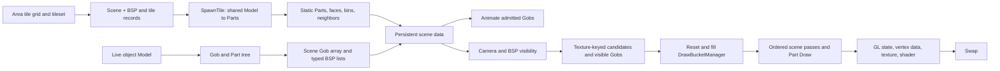

# Original world build, storage, and render cadence

Pinned executable: `nwmain.exe` SHA-256 `3b7cb1252e0edb2ce22d7971f333aade027039ae30a45b4bc64732c3e6bec73a`. This is a synthesis of original-binary branches in the linked NWN-75 maps, with the `Scene::Render` and `Scene::RenderDynamicGeometry` call order rechecked through REA/Ghidra. It describes when a function is **eligible** to run. There is no matched native Arelith call-count trace here, so it does not assign an observed number of calls per displayed frame or a cost to any branch.

## How an area becomes a renderable world

1. The area-entry handler `FUN_1407dba70` creates a named `mainscene` and stores its pointer in area state `+0x248`. `NewCAurScene` allocates a `0x518`-byte Scene; its constructor creates draw-bucket, light, and wind managers and registers the Scene globally. The handler obtains the tileset, allocates `0x60` bytes per tile for its tile records, and initializes a BSP using tile dimensions, border `5`, cell size `10.0`, and bin initialization. BSP node initialization allocates a `0xa0`-byte payload per node. It suspends texture updates during per-tile loading and resumes them afterward. [Area entry and Scene construction](scene-lifecycle-area-entry.md).
2. For each tile, the handler resolves `CNWTileData`, records tile ID/orientation/height, and calls `Scene::SpawnTile` with its model resref. `SpawnTile` uses `FindModel`, builds a Part tree, applies rotation, expands referenced models, collapses the tree, and classifies static Parts. `ProcessStaticParts` routes eligible triangular faces into Scene bins, computes bounds, and handles special Parts. Eligible Parts may be combined and placed in the BSP; neighboring tiles and border lists are then linked. This preparation belongs to area entry, not the normal frame loop. [Area entry](scene-lifecycle-area-entry.md), [Model construction](model-instance-branch.md).
3. Live model objects follow `NewCAurObject` → shared `Model`/`MdlNode` data → a per-Gob typed `Part` tree, postprocessing, references, materials and vertex primitives. `Gob::SetScene` detaches from an old Scene, attaches to the new Scene's Gob array at `+0x130/+0x138`, places the Gob in BSP membership, recursively registers special light/emitter Parts, and increments `Scene::Sequence`. Removal reverses those memberships. BSP membership stores typed node payloads: light `+0x0`, Gob `+0x10`, mesh `+0x20`, emitter `+0x30`, shadow `+0x40`, beam `+0x50`, generic Part `+0x60`, trigger `+0x70`, single AABB `+0x90`, and tile data `+0x98`. [Model construction](model-instance-branch.md), [scene attachment](animation-and-emitter.md), [BSP membership](scene-bsp-membership.md), [tile payload](scene-lifecycle-area-entry.md).

The native constructor test also created two Gobs for the same installed tile and read the **same Model pointer** from each. That directly confirms shared Model ownership in that controlled run; it does not show how many tile Gobs an Arelith area uses. [Runtime constructor test](../native-render-gap/original/constructor-runtime-test.md).

| Persistent store | Contents and lifetime |
| --- | --- |
| Area tile records | Tile identity, placement/height, a `CAurObject*` at record `+0x38`, and neighbor/border relationships; built for the area. |
| Model table | Shared parsed Model and typed MdlNode hierarchy; resource lookup/cache gates choose whether bytes are demanded or parsed again. |
| Gob / Part tree | Per-object pose, animation runs, active LOD root, render flags and typed Part children; attached to a Scene until moved/removed. |
| Scene and BSP | Scene Gob array, managers, bins and BSP node payloads with typed lists; static tile Parts and moving objects remain represented between frames. |
| Textures and vertex resources | Referenced textures, GL IDs, vertex primitives/VDO pools and cached shader state can outlive an individual draw; build/upload paths have pending or dirty gates. |
| DrawBucketManager | 16 item types × three cull-face groups: 48 counted arrays. `Reset` clears counts each collection pass and retains backing capacity. Items are transient selections of persistent Parts. |

Sources: [scene lifecycle](scene-lifecycle-area-entry.md), [model instance](model-instance-branch.md), [BSP membership](scene-bsp-membership.md), [bucket storage](bucket-classification.md), [texture publication](texture-publication-per-frame.md), [state gates](render-state-boundaries.md).

## Work done for a rendered world view

The outer update reaches `CGuiMan::UpdateAndRender`. Under its animation gate, it calls `Scene::Animate` for registered scene views and two special views. Its render loop calls the registered cameras, then Nuklear UI, then the two special-view cameras; the outer update draws posted text/console and swaps afterward. Each camera skips a null Scene or fully offscreen explicit viewport, otherwise sets viewport/projection/view and invokes `Scene::Render`. A Scene without BSP uses the simple Gob path, usually relevant to GUI views. [GUI order](gui-presentation.md), [camera entry](camera-entry.md), [render tree](original-render-tree.md).

For a BSP-backed world `Scene::Render` first processes pending texture publication, sets scene/camera state, and calls `ManageSceneBSP`. It checks changed full-dynamic-lighting mode for BSP light/bin relighting, updates wind time and uniform dirty data, resets/fills draw buckets with `AddPartsToDrawBuckets`, and invokes `RenderSinglePass`. `AddPartsToDrawBuckets` walks texture-keyed static mesh/fade candidate lists before visible Gobs. For live Gobs it sorts the visible bucket, checks `Gob::ProcessGob`, composes attachment transforms, and recursively classifies renderable Parts. The bucket manager does **not** rebuild items while a draw pass traverses them. [Per-render BSP maintenance](scene-bsp-frame-maintenance.md), [visible-node callback](scene-bsp-visible-callback.md), [bucket classification](bucket-classification.md), [geometry and draw](geometry-and-draw-boundary.md). Direct REA recheck: `Scene::Render` `0x1400cc730`, `AddPartsToDrawBuckets` `0x1400c38f0`.

The ordered `Scene::RenderSinglePass` calls are grouped below. “Called” is distinct from “draws”: most helpers inspect flags or empty buckets before meaningful work. The complete 23-stage call order is in [render-single-pass](render-single-pass.md).

| Order | Main world route |
| --- | --- |
| 1 | Main-scene framebuffer setup; light and shadow-list setup; fog and door fade. |
| 2 | Static opaque bucket **0**. |
| 3 | Skyboxes, then static transparent bucket **1**. |
| 4 | Grass/bin geometry, fade caps **7**, highlighted objects and triggers. |
| 5 | Conditional dynamic shadows, then `RenderDynamicGeometry`: dynamic opaque **2**, dynamic transparent **3**. |
| 6 | If present, framebuffer-sampling bucket **5** with a main-scene subframe copy; emitter lighting; fade bucket **8**; conditional static shadows. |
| 7 | Conditional main-scene pre-water effects; fog/light state; if present, water bucket **6** with subframe copy; trigger highlight. |
| 8 | Optional wireframe replay of selected buckets; additive bucket **4**, beams, then emitter simulation/draw and lens flares. |
| 9 | Main-scene post-water effects; drawable squares, scene lines and optional light-range debug draw. |

`Scene::RenderDynamicGeometry` directly calls `RenderDrawBucket(2)` and then `(3)` in the pinned binary (`0x1400ce110`, REA direct recheck). `RenderDrawBucket` traverses three cull-face groups, applies model/material/fog/fade state, calls typed `Part::Draw`, then restores temporary state. The latter reaches vertex submission and GL draw APIs. A `SharedMaterial.volumetric` Part intentionally enters two buckets; wireframe intentionally replays buckets when enabled. Those are authored effects, not accidental repeat draws. [Bucket classification](bucket-classification.md), [geometry and draw](geometry-and-draw-boundary.md), [pass order](render-single-pass.md).

## How often stored data is revisited

| Trigger | Revisited work | Work avoided or deferred |
| --- | --- | --- |
| Area entry / scene change | Tile Model lookup, Part/reference expansion, static-bin construction, BSP membership and neighbor links. | Not on the ordinary frame path. Teardown detaches Gobs and destroys BSP/bin state; main-scene VDO repack is conditional. |
| Eligible GUI update | `Scene::Animate` walks its Gob array in reverse order; `Gob::Animate` checks behavior, scene/force animation, visibility, model and fade gates. Admitted runs advance hierarchy/events and recurse Parts. | Ineligible Gobs skip the deeper animation-run work; an admitted Gob recomputes its minimum sphere every **fifth** visit, not every visit. |
| Every `Scene::Render` invocation with a BSP | `ManageSceneBSP` refreshes light selection, traverses approximate visible BSP nodes, tests candidate bounds, builds texture-keyed candidates, then `AddPartsToDrawBuckets` resets and refills 48 logical draw lists. | Static tile Model/Part trees and bucket backing arrays remain allocated. Array growth occurs only on capacity exhaustion. |
| Camera origin moves over `0.3` or Scene sequence changes | Visibility origin is invalidated; moving Part/Gob BSP membership can be reconsidered. Moving Parts also update when their world position changes. | If already in the correct node, typed membership remains; no tile rebuild follows from camera motion. |
| Visible Gob / LOD test | Bounding sphere and camera distance are tested; `SetLODModel` is eligible for visible Gobs. `Gob::ProcessGob` is called during draw collection. | LOD `Reset` and active-root swap occur only when selected level changes. `ProcessGob`'s geometry-flag tree walks require its dirty byte. |
| Visible grass bin | Active bins are collected each render and wind/distance can advance. | `BuildGrassPolys` checks whether its geometry item already exists; no rebuild on an unchanged active bin. Inactive bins can destroy their polygons. |
| Texture / light / shader state | `AurTextureMakeCurrent` is reached at scene entry; light positions and selected-light priorities are refreshed. Programs and draws consume state. | Texture image build/sort is pending-work gated; static relighting needs a lighting-mode change or queued nodes; GL uniforms compare per-program generation counters; cached light/fog/state setters skip unchanged values. |
| Emitter pass | Visible emitter bucket can simulate particles and then render live particles after additive geometry. | `IsAnimating`/force gate controls simulation; empty/live and authored render-mode gates control draw. No separate particle worker is proven. |

Sources: [animation](original-scene-animation-nonemitter.md), [BSP maintenance](scene-bsp-frame-maintenance.md), [visible callback](scene-bsp-visible-callback.md), [light selection](scene-light-selection.md), [texture publication](texture-publication-per-frame.md), [shader dirty gates](shader-uniform-dirty-gates.md), [particle route](animation-and-emitter.md).

## Limits and useful comparison points

This map gives **per-invocation recurrence**, not measured Arelith call counts. Multiple active cameras, loading-screen `UpdateScreen` reentry, settings and authored content can change how many Scene renders or optional passes run before one swap. The area-entry caller's thread and actual active camera count are still open. `PartDanglyMesh::Animate` can be reached both through the regular Part animation path and render-stage mesh admission; the static tree does not establish whether one instance takes both routes in one frame. [GUI order](gui-presentation.md), [loading reentry](scene-lifecycle-area-entry.md), [Dangly path](original-scene-animation-nonemitter.md).

For a client comparison, count **per displayed frame**: main-scene camera renders, BSP nodes tested, candidate/visible static meshes and Gobs, Part-tree visits, bucket submissions by type, actual GL/Godot draws, light scans, texture builds and changed buffer uploads. The key distinction to test is whether our client repeatedly prepares persistent geometry/resources or submits more candidate objects than the original. The static native tree alone cannot establish either difference or its FPS cost. [Bounded client comparison](../native-render-gap/bounded-original-client-comparison.md).
